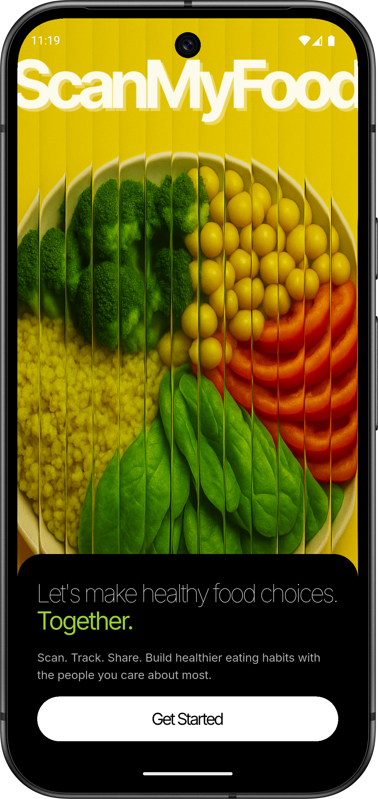
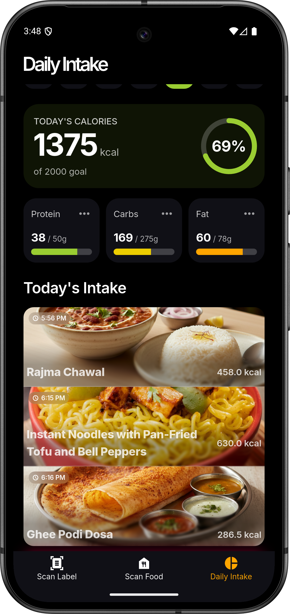
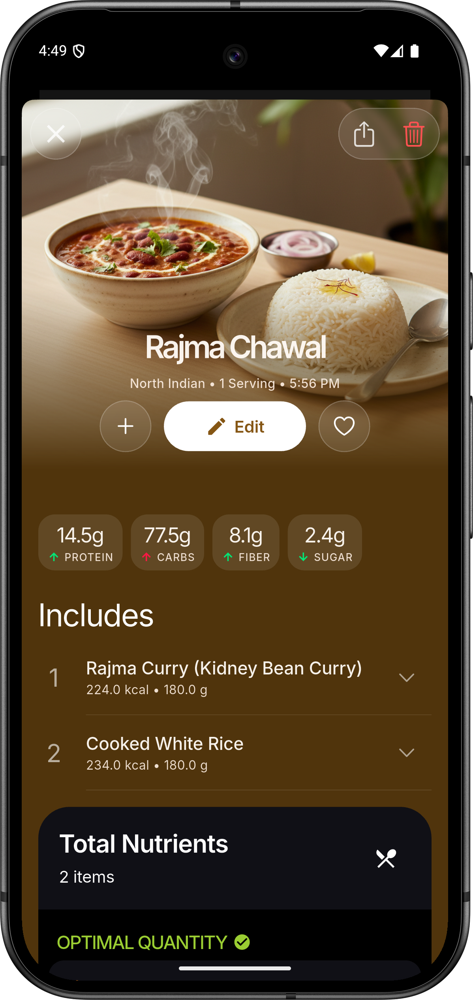
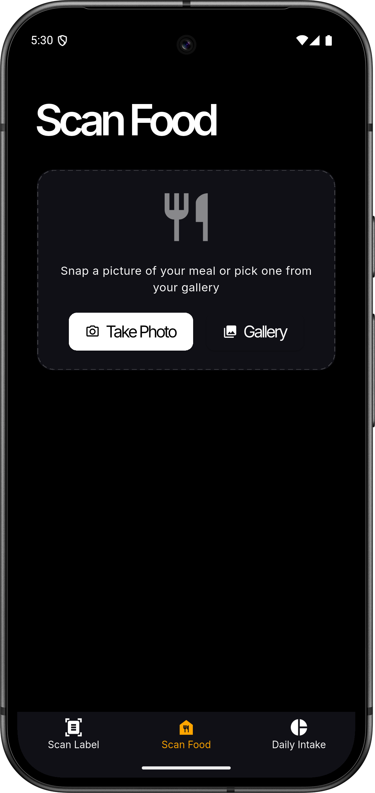
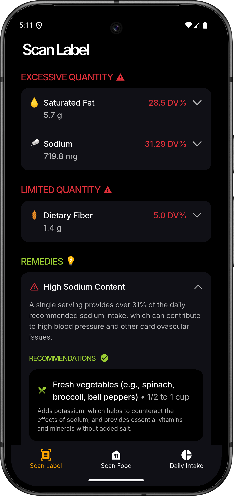
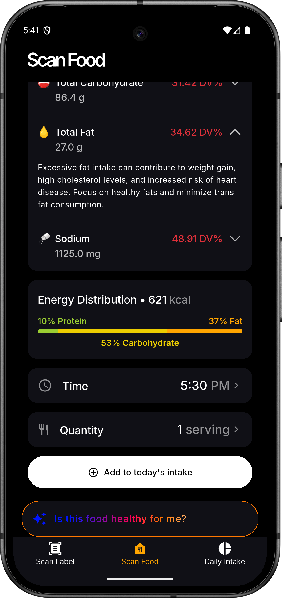
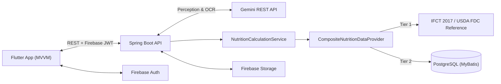

<p align="center">
  
</p>

<h1 align="center">ScanMyFood</h1>

<p align="center">
  <strong>AI-Powered Nutrition Intelligence — Know what you eat, instantly.</strong>
</p>

<p align="center">
  
  
  
  
  
  
</p>

## 📖 Overview

**ScanMyFood** is a food-scanning and nutrition-tracking platform built with **Flutter**, **Spring Boot**, **PostgreSQL**, and the **Gemini API**.

Instead of relying on an LLM to guess calories or perform arithmetic, ScanMyFood uses a **hybrid AI + deterministic nutrition pipeline**: Gemini handles visual perception, dish decomposition, and nutrition-label OCR, while the Spring Boot backend performs unit normalization, verified database lookups (**IFCT 2017** & **USDA FoodData Central**), and deterministic nutrient math.

## ✨ Key Features

- **📸 Scan Food (Prepared Meals)**: Captures meal photos, decomposes mixed dishes (e.g., *Rajma Chawal* into rice + curry), estimates portions, and calculates nutrition deterministically.
- **🏷️ Scan Label (Packaged Food)**: Extracts per-serving values and serving sizes via multimodal OCR, calculates `% Daily Value`, normalizes to per-100g, and saves verified product records.
- **✍️ Manual Intake & AI Chat**: Log meals via natural-language descriptions or converse with the AI assistant backed by Spring AI MCP tools.
- **📊 Daily Intake & Aggregation**: Tracks daily macros and micronutrients with dynamic portion scaling from normalized per-100g records.
- **👤 Personalized Health Profiles**: Tailors label concerns and complementary food recommendations to the user's BMI, goals, region, and pre-existing health conditions.
- **🔐 Secure Cloud Sync**: Firebase Authentication and Firebase Storage, with the backend deployed on Railway.

## 📱 Screenshots

|                                                      |                                                          |                                                            |
| :--------------------------------------------------: | :------------------------------------------------------: | :--------------------------------------------------------: |
|  |    |  |
|   |  |     |

## 🏗️ Architecture

ScanMyFood separates **AI perception** from **deterministic nutrition calculation** across all three input pipelines:



### Nutrition Calculation Pipeline

1. **AI Perception & OCR (`VertexAiServiceImpl`)**
   - **Scan Food / Text Description**: Gemini identifies visible meal components, distinguishes cooked vs. raw states, and returns canonical `snake_case` names with estimated quantities and units (`g`, `ml`, `piece`, `cup`, `tbsp`).
   - **Scan Label**: Gemini extracts structured per-serving nutrient values and serving size from packaged food labels, safely parsed via `FlexibleDoubleDeserializer`.
2. **Unit Normalization & Deduplication (`NutritionCalculationServiceImpl`)**
   - Merges duplicate ingredients on a plate.
   - Converts food-specific household units into grams (e.g., `roti` piece = `35g`, `boiled_egg` = `50g`, cooked `rice` cup = `150g`, `dal`/`curry` cup = `240g`).
3. **Tiered Reference Lookup & Scaling (`CompositeNutritionDataProvider`)**
   - **Tier 1 (`VerifiedReferenceNutritionProvider`)**: In-memory verified records from **IFCT 2017** (Indian Food Composition Tables) and **USDA FoodData Central**, with synonym resolution.
   - **Tier 2 (`DatabaseNutritionProvider`)**: PostgreSQL `food_item_dictionary` (seeded with verified IFCT/USDA records and upserted with verified scanned labels).
   - **Baseline Fallback**: Uses a safe baseline profile (`ESTIMATED_BASELINE`) for unknown items without polluting verified dictionary entries.
   - Validates energy consistency against the **Atwater 4-4-9 system** (`protein * 4 + carbs * 4 + fat * 9`).
4. **Per-100g Persistence & Dynamic Aggregation (`UserIntakeServiceImpl`)**
   - All `food_item_dictionary` and `product_label` entries are stored normalized **per 100g**, allowing daily intake totals and portion edits to recalculate accurately at query time.

### Project Map

```bash
├── flutter-app/                                  # Mobile Frontend (Flutter / Dart)
│   ├── lib/                                      # ViewModels, Repositories, Services, Views
│   └── assets/                                   # Branding, Icons, and Rive Animations
└── spring-backend/                               # RESTful Backend (Spring Boot / Java 17)
    ├── src/main/java/com/scanmyfood/backend/
    │   ├── controllers/                          # REST & AI endpoints
    │   ├── services/nutrition/                   # Deterministic calculation & IFCT/USDA providers
    │   ├── services/                             # Intake persistence, AI orchestration, storage
    │   ├── mapper/                               # MyBatis mappers
    │   ├── models/                               # DTOs & domain models
    │   └── tools/                                # Spring AI MCP tool definitions
    └── src/main/resources/
        ├── mapper/                               # MyBatis XML SQL mappings
        └── schema.sql                            # PostgreSQL schema & IFCT/USDA seed data
```

## 🛠️ Tech Stack

### Frontend

- **Framework**: [Flutter](https://flutter.dev/) (MVVM Architecture)
- **State Management**: Provider
- **Visuals**: Rive (Animations), `fl_chart` (Data Visualization)
- **Authentication**: Firebase Auth / Google Sign-In

### Backend

- **Framework**: [Spring Boot 3.5.0](https://spring.io/projects/spring-boot) (Java 17)
- **Database & Persistence**: PostgreSQL + [MyBatis](https://mybatis.org/spring-boot-starter/mybatis-spring-boot-autoconfigure/) (H2 in-memory for tests)
- **AI Engine**: Gemini Developer REST API (`gemini-flash-latest` / `gemini-3.5-flash-lite` fallback chain) + Spring AI MCP Server
- **Auth & Storage**: Firebase Admin SDK
- **Deployment**: Railway (auto-deploys from `main`)

---

## 🚀 Getting Started

### Prerequisites

- **Flutter SDK**: `>=3.4.3`
- **JDK**: `17+`
- **Database**: PostgreSQL `14+`
- **Cloud**: Gemini API Key & Firebase Project

### 1. Backend Setup

1. Navigate to `spring-backend/`.
2. Configure `application.properties` (or `application-local.properties`) with your PostgreSQL credentials and `gemini.api.key`.
3. Place your Firebase service account key as `firebase-service-account.json` in `src/main/resources/`.
4. Run the server (database tables and IFCT/USDA seed data initialize automatically via `schema.sql`):
   ```bash
   ./mvnw spring-boot:run
   ```
5. Run backend tests:
   ```bash
   ./mvnw test
   ```

### 2. Frontend Setup

1. Navigate to `flutter-app/`.
2. Add your `google-services.json` (Android) or `GoogleService-Info.plist` (iOS).
3. Install dependencies:
   ```bash
   flutter pub get
   ```
4. Run:
   ```bash
   flutter run
   ```

---

## 🤝 Contributing

We welcome contributions! Please follow these steps:

1. Fork the Project
2. Create your Feature Branch (`git checkout -b feature/AmazingFeature`)
3. Commit your Changes (`git commit -m 'Add some AmazingFeature'`)
4. Push to the Branch (`git push origin feature/AmazingFeature`)
5. Open a Pull Request

## 📄 License

Distributed under the MIT License. See `LICENSE` for more information.

## 💖 Acknowledgments

- [Google Gemini API](https://ai.google.dev/) for multimodal perception and OCR.
- **IFCT 2017** (ICMR-NIN) and **USDA FoodData Central** for verified nutritional reference data.
- [Flutter](https://flutter.dev/) and [Spring Boot](https://spring.io/) communities.

<p align="center">Made with ❤️ for a healthier world</p>
